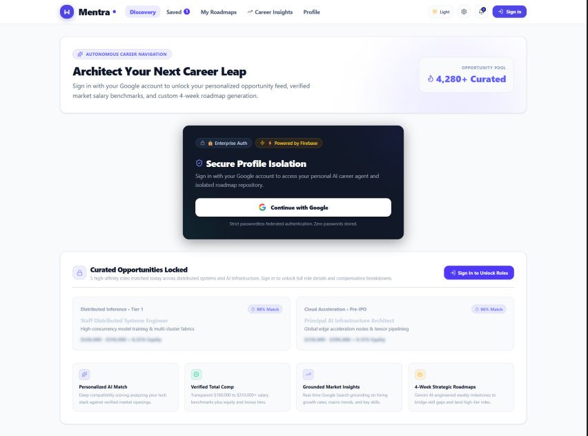
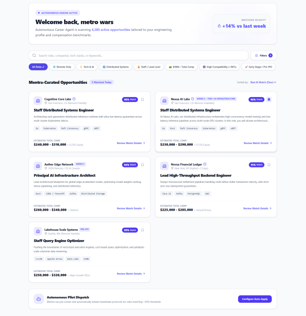
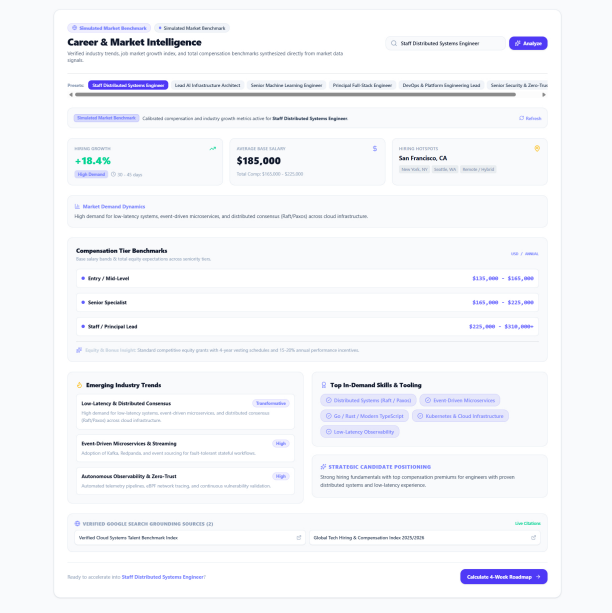

# Mentra

An AI career mentor for students. You describe your background and the role you want, and Mentra scores your fit, finds the skill gaps, and builds a week-by-week roadmap you can keep asking questions about.

**Live app:** [mentra on Cloud Run](https://mentra-346119786628.asia-southeast1.run.app) · built during the Google Cloud Gen AI Academy APAC (Cohort 3)

## Screenshots

| Sign-in | Dashboard | Career insights |
|---|---|---|
|  |  |  |

## Features

- **Role-fit analysis:** compares your profile with a target role and returns a match score
- **Skill-gap breakdown:** the specific technical skills you're missing for that role
- **4-week roadmap:** a structured plan generated as JSON and rendered as a checklist
- **Mentor chat:** multi-turn follow-up questions, with your saved roadmap as context
- **Career insights:** market trends and compensation ranges for the role
- **Saved roadmaps** per user, stored in Firestore

## How it works

```
React app ──Firebase ID token──▶ Express server (server.ts) ──▶ Gemini API
                                        │
                                        └──▶ Firestore (roadmaps, chat history)
```

- Users sign in with Google through **Firebase Authentication**.
- Every API route (`/api/generate-roadmap`, `/api/career-insights`, `/api/chat`) verifies the Firebase ID token on the server with `firebase-admin` before doing anything.
- The server asks **Gemini** for JSON output (`responseMimeType: application/json`), so roadmaps come back structured instead of free text.
- **Firestore security rules** deny by default and scope every document to its owner's UID.
- The Gemini API key is read from the environment at runtime and never reaches the browser.
- The whole app is deployed as one container on **Google Cloud Run**.

## Tech stack

React 19 · TypeScript · Vite · Tailwind CSS · Express · Gemini API (`@google/genai`) · Firebase Auth · Cloud Firestore · Google Cloud Run

## Running locally

```bash
git clone https://github.com/sumanthkatta-dev/Mentra-AI.git
cd Mentra-AI
npm install
cp .env.example .env    # set GEMINI_API_KEY
npm run dev
```

Firebase project settings go in `firebase-applet-config.json`.

## Project structure

```
server.ts           Express API: auth middleware, Gemini calls, serves the Vite build
src/components/     RoadmapForm, RoadmapDisplay, MentorChat, CareerInsights, DiscoveryView, …
firestore.rules     Per-user access rules
app.py              Earlier Flask prototype of the mentor-chat endpoint
```
